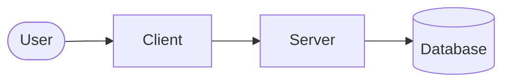

# Architecture

The system as it is now, on one page. Reasons live in `docs/adr/`.

| Part | Responsibility | Where |
|---|---|---|
| Client | <What it owns> | `<top-level directory>` |
| Server | <What it owns> | `<top-level directory>` |

Name top-level directories only. File paths go stale.

## Principles

Cross-cutting rules every part follows. At most ten, each linking the ADR that explains it.

- Margin never writes to a document or to anything next to it. Every file a page loads comes through `margin://`, read by the process that shows the page, and folder access is asked for only when a page is missing a file (ADR-0004).
- Markdown pages run only the app's bundled scripts, and Margin fetches nothing from the network for itself; a document's own web content loads as in a browser (ADR-0002).
- The app and the Quick Look extension show documents through one reader, the `MarginReader` package (ADR-0003).
