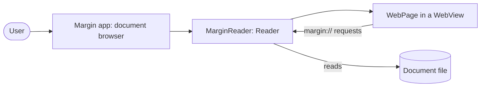

# Architecture

The system as it is now, on one page. Reasons live in `docs/adr/`.

| Part | Responsibility | Where |
|---|---|---|
| Margin app | The iOS and iPadOS app: the document browser and its menus, built on the reader | `Margin/` |
| MarginReader | The reader the app and the Quick Look extension share: page building, `margin://` handling, the bundled web files, folder grants, and text decoding (ADR-0003) | `MarginReader/` |
| Tests | Acceptance tests citing requirement IDs, in Swift Testing inside the app and in XCUITest driving it, and other tests | `tests/` |

Name top-level directories only. File paths go stale.

## Principles

Cross-cutting rules every part follows. At most ten, each linking the ADR that explains it.

- Margin never writes to a document or to anything next to it. Every file a page loads comes through `margin://`, read by the process that shows the page, and folder access is asked for only when a page is missing a file (ADR-0004).
- Markdown pages run only the app's bundled scripts, and Margin fetches nothing from the network for itself; a document's own web content loads as in a browser (ADR-0002).
- The app and the Quick Look extension show documents through one reader, the `MarginReader` package (ADR-0003).
