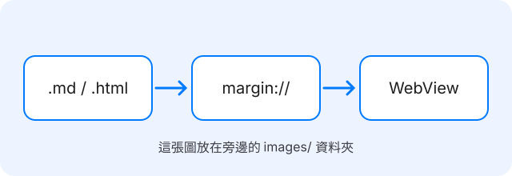

# 歡迎使用 Margin

一個**極簡**、有*原生感*的 Markdown 與 HTML 閱讀器。字型跟著系統的「文字大小」設定，深色模式自動切換。



## 支援的語法

- 粗體、斜體、~~刪除線~~、`行內程式碼`
- [外部連結](https://www.apple.com) 會交給 Safari 開啟
- [另一份文件](Report.html) 會在這裡直接打開
- 巢狀清單
  - 第二層
- [x] 待辦清單（已完成）
- [ ] 待辦清單（未完成）

> 引言：保持簡單，把系統做得好的事情交給系統。

```swift
let viewer = "Margin"
print("Hello, \(viewer)")
```

| 功能 | 狀態 | 備註 |
|:-----|:----:|-----:|
| Markdown | ✅ | 內建解析器 |
| HTML | ✅ | 原樣顯示 |
| 周邊圖片 | ✅ | 授權資料夾一次 |

---

最後一段。
